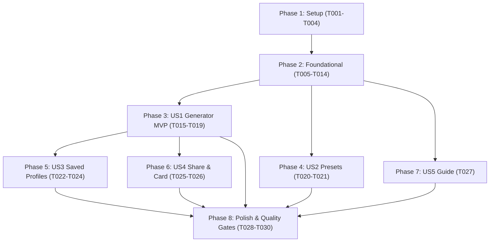

# Tasks: SensiX Free Fire Sensitivity Generator

**Input**: Design documents from `/specs/001-sensix-sensitivity-generator/`  
**Prerequisites**: `plan.md`, `spec.md`, `research.md`, `data-model.md`, `contracts/`, `quickstart.md`  

## Format: `- [ ] [TaskID] [P?] [Story?] Description with file path`

- **[P]**: Parallelizable task (different files, no blocking dependencies)
- **[Story]**: User story identifier (`[US1]`, `[US2]`, `[US3]`, `[US4]`, `[US5]`)
- Every task includes an explicit, actionable file path.

---

## Phase 1: Setup (Shared Infrastructure)

**Purpose**: Dependency installation, styling configuration, and PWA scaffolding

- [x] T001 Install `lucide-react` icons in `my-app/package.json`
- [x] T002 [P] Configure dark gaming theme tokens, glow utilities, and grid overlay in `my-app/app/globals.css`
- [x] T003 [P] Create PWA Web App Manifest in `my-app/public/manifest.json` and SVG brand icon in `my-app/public/icon.svg`
- [x] T004 [P] Implement offline service worker in `my-app/public/sw.js` and client registration component in `my-app/components/RegisterSW.tsx`

---

## Phase 2: Foundational (Core Domain Logic & Layout Architecture)

**Purpose**: Core calculation engine, data repositories, layout frames, and notification infrastructure

**⚠️ CRITICAL**: Foundational tasks must be completed before UI story integration.

- [x] T005 [P] Implement pure sensitivity calculation engine, modifier weights, and clamp functions in `my-app/lib/sensitivity.ts`
- [x] T006 [P] Implement 29+ curated device specifications and custom hardware fallbacks in `my-app/lib/devices.ts`
- [x] T007 [P] Implement 6 curated benchmark preset definitions in `my-app/lib/presets.ts`
- [x] T008 [P] Implement localStorage profile persistence, schema validation, and JSON export/import in `my-app/lib/storage.ts`
- [x] T009 [P] Implement clipboard text formatting and slug helpers in `my-app/lib/format.ts`
- [x] T010 Implement global ToastProvider context and `useToast` hook in `my-app/components/ToastProvider.tsx`
- [x] T011 [P] Implement responsive top navigation header with active link states in `my-app/components/Navbar.tsx`
- [x] T012 [P] Implement fixed mobile bottom tab navigation with safe-area padding in `my-app/components/BottomNav.tsx`
- [x] T013 [P] Implement fan-made legal disclaimer and brand footer in `my-app/components/Footer.tsx`
- [x] T014 Assemble root application layout integrating ToastProvider, Navbar, BottomNav, Footer, and PWA registration in `my-app/app/layout.tsx`

**Checkpoint**: Foundational layer complete — UI user stories can now proceed.

---

## Phase 3: User Story 1 - Interactive Sensitivity Generator (Priority: P1) 🎯 MVP

**Goal**: Deliver the primary interactive sensitivity generator allowing players to configure device specs, playstyle, grip, and DPI to obtain real-time calibrated sensitivities and fire button sizing.

**Independent Test**: Navigate to `/generator`, select device and playstyle, verify 6 scope meters and fire button gauge update dynamically within valid bounds (1–100 and 30–80).

- [x] T015 [P] [US1] Implement animated sensitivity meter bars (`role="meter"`) in `my-app/components/SensBars.tsx`
- [x] T016 [US1] Implement reusable ResultCard component with scope meters, fire button size row, and action slots in `my-app/components/ResultCard.tsx`
- [x] T017 [US1] Implement interactive two-column Generator controls (Device select, Playstyle radio, Fingers, Experience, DPI) in `my-app/components/Generator.tsx`
- [x] T018 [US1] Implement Generator page route with sticky ResultCard and tactical tips in `my-app/app/generator/page.tsx`
- [x] T019 [US1] Implement Home landing page with Hero section, live preview card, stats banner, features grid, FAQ, and final CTA in `my-app/app/page.tsx`

**Checkpoint**: User Story 1 functional — SensiX core MVP is fully operational!

---

## Phase 4: User Story 2 - Instant Expert Presets (Priority: P2)

**Goal**: Provide instant access to 6 pre-calibrated sensitivity presets with 1-click clipboard copy.

**Independent Test**: Navigate to `/presets`, inspect 6 preset cards, click "Copy" and verify formatted text is copied with toast confirmation.

- [x] T020 [P] [US2] Implement PresetGrid component displaying 6 benchmark cards with staggered entry animations in `my-app/components/PresetGrid.tsx`
- [x] T021 [US2] Implement Presets catalog page route with header and preset grid in `my-app/app/presets/page.tsx`

**Checkpoint**: User Stories 1 & 2 fully operational.

---

## Phase 5: User Story 3 - Local Profile Management & Data Portability (Priority: P2)

**Goal**: Enable players to save customized profiles locally in browser storage, manage/delete entries, and export/import JSON backups.

**Independent Test**: Save a profile on `/generator`, navigate to `/saved`, verify presence, download JSON backup, delete profile, and restore via JSON upload.

- [x] T022 [P] [US3] Implement SavedList component with empty state, card deletion, and JSON import/export triggers in `my-app/components/SavedList.tsx`
- [x] T023 [US3] Implement Saved profiles page route in `my-app/app/saved/page.tsx`
- [x] T024 [US3] Integrate inline profile naming and localStorage save handler into `my-app/components/ResultCard.tsx`

**Checkpoint**: User Stories 1, 2, and 3 fully operational.

---

## Phase 6: User Story 4 - Social Sharing & High-Res Card Download (Priority: P3)

**Goal**: Provide 1-click social sharing (WhatsApp/Web Share) and direct 1080x1350 PNG graphic card download via HTML5 Canvas.

**Independent Test**: Click "Card" on any result card, confirm 1080x1350 PNG file downloads crisply with glowing styling, scope meters, and fire button size.

- [x] T025 [P] [US4] Implement HTML5 Canvas 1080x1350 high-DPI card renderer and PNG download utility in `my-app/lib/card.ts`
- [x] T026 [US4] Integrate native Web Share with WhatsApp link fallback and PNG download triggers into `my-app/components/ResultCard.tsx`

**Checkpoint**: User Stories 1 through 4 operational.

---

## Phase 7: User Story 5 - In-Game Calibration & Training Guide (Priority: P4)

**Goal**: Offer structured education on applying sensitivity settings in Free Fire, practicing a 10-minute training routine, and fine-tuning.

**Independent Test**: Navigate to `/guide`, verify 4 educational cards render with complete tactical guidance.

- [x] T027 [US5] Implement 4-card educational tutorial and training grounds routine page in `my-app/app/guide/page.tsx`

**Checkpoint**: All 5 user stories complete!

---

## Phase 8: Polish & Cross-Cutting Concerns

**Purpose**: Validation, boundary testing, type checking, production build, and documentation.

- [x] T028 [P] Implement boundary validation test suite verifying all scopes (1–100) and fire button (30–80) across all devices and playstyles in `my-app/lib/sensitivity.test.ts`
- [x] T029 Execute TypeScript strict analysis (`npx tsc --noEmit`) and production build (`npm run build`) in `my-app`
- [x] T030 Update project documentation and formula tuning instructions in `my-app/README.md`

---

## Dependencies & Execution Order

